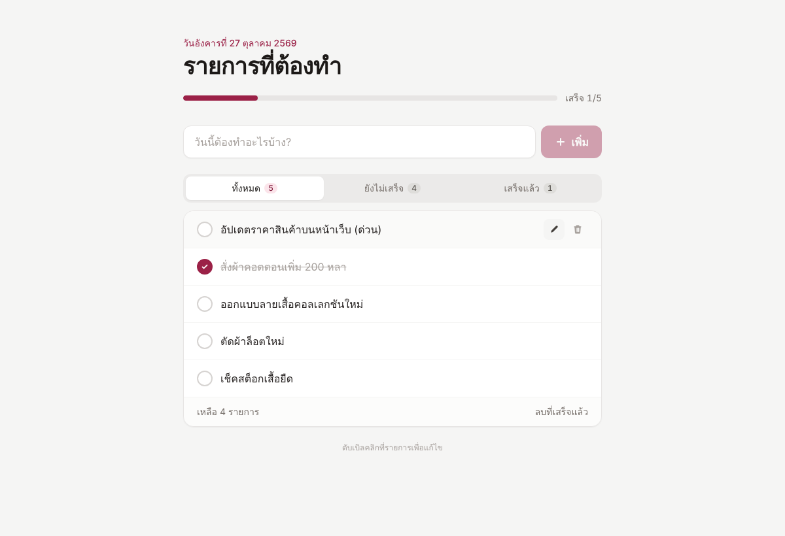
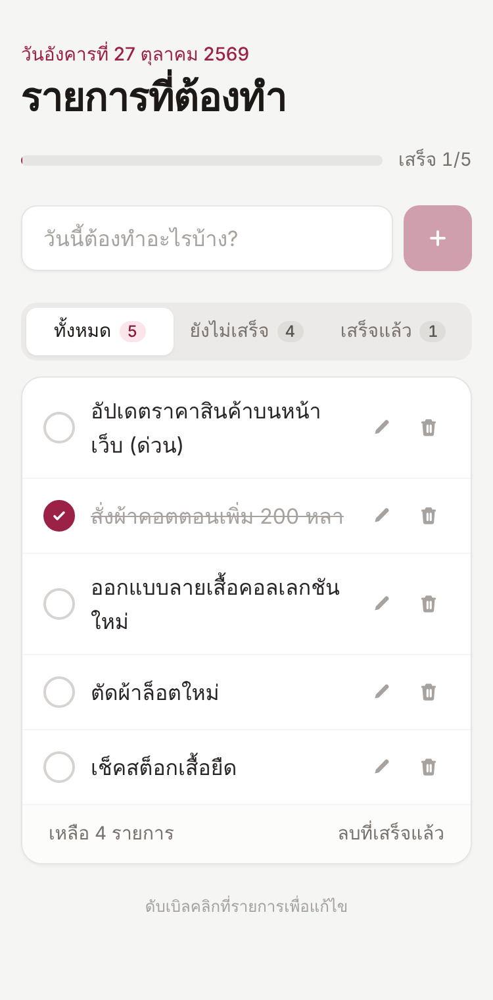

# Todo List — Frontend

เว็บแอป Todo List พัฒนาด้วย **Vue.js 3** + **TypeScript** + **Tailwind CSS** เชื่อมต่อกับ RESTful API ที่สร้างด้วย AdonisJS 5

Backend: [todo-api](https://github.com/<your-username>/todo-api)

| Desktop | Mobile |
| ------- | ------ |
|  |  |

## ฟีเจอร์

- เพิ่มรายการ todo
- ลบรายการ (มีกล่องยืนยันก่อนลบ) และลบรายการที่เสร็จแล้วทั้งหมดได้
- ทำเครื่องหมายว่าเสร็จแล้ว / ยังไม่เสร็จ
- แก้ไขชื่อรายการ (กดไอคอนดินสอ หรือดับเบิลคลิก, Enter เพื่อบันทึก, Esc เพื่อยกเลิก)
- กรองรายการ: ทั้งหมด / ยังไม่เสร็จ / เสร็จแล้ว พร้อมแถบแสดงความคืบหน้า
- ทุกการกระทำส่ง request ไปที่ API และบันทึกลงฐานข้อมูล รีเฟรชหน้าเว็บแล้วข้อมูลยังอยู่
- Responsive รองรับทั้งมือถือและเดสก์ท็อป
- แสดงสถานะกำลังโหลด และแจ้งเตือนเมื่อเชื่อมต่อ API ไม่ได้พร้อมปุ่มลองใหม่

## เทคโนโลยีที่ใช้

- Vue.js 3 (Composition API, `<script setup>`)
- TypeScript
- Tailwind CSS
- Vite

## วิธีติดตั้งและรัน

ต้องรัน [todo-api](https://github.com/<your-username>/todo-api) ไว้ก่อน (ค่าเริ่มต้น `http://localhost:3333`)

```bash
# 1. ติดตั้ง dependencies
npm install

# 2. ตั้งค่า URL ของ API (แก้ได้ถ้า API อยู่ที่อื่น)
cp .env.example .env

# 3. รัน development server (http://localhost:5173)
npm run dev

# build สำหรับ production
npm run build
```

## โครงสร้างโปรเจกต์

```
src/
  App.vue                     # หน้าหลัก
  components/
    TodoForm.vue              # ช่องเพิ่มรายการ
    TodoItem.vue              # แต่ละรายการ (ติ๊ก แก้ไข ลบ)
    TodoFilterTabs.vue        # แท็บกรองรายการ
  composables/useTodos.ts     # state และ logic ทั้งหมดของ todo
  services/todoApi.ts         # ฟังก์ชันเรียก RESTful API
  types/todo.ts               # TypeScript types
```
